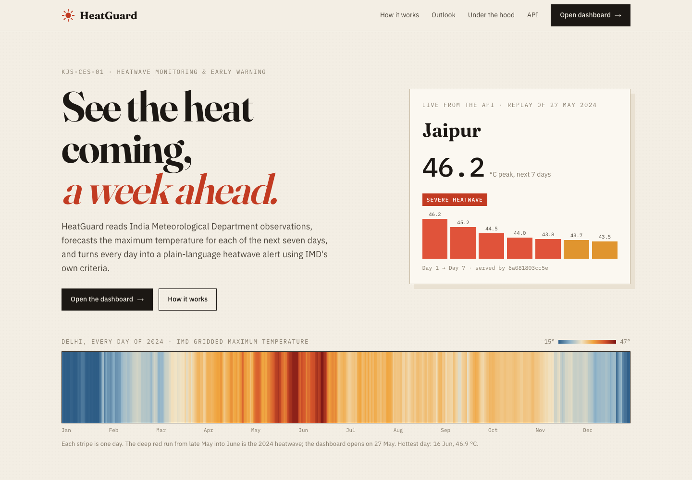
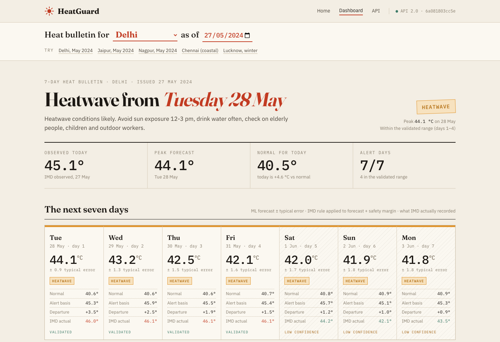
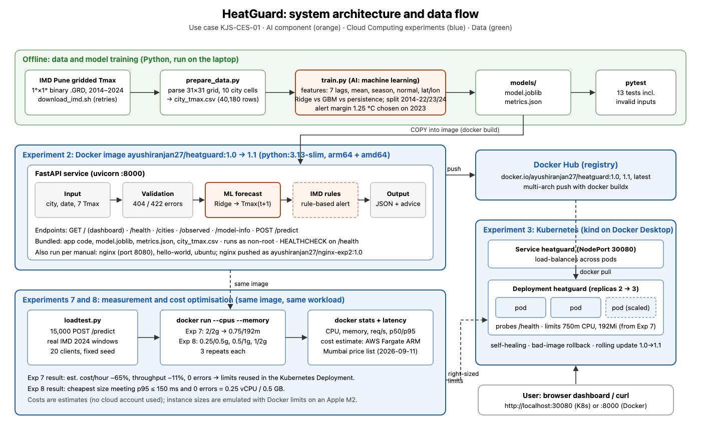

# HeatGuard: 7-day Heatwave Forecast & Early Warning (Cloud Computing Mini Project)

**Ayushi Ranjan · Roll No. 16014223028 · Batch B1 · KJSSE, Somaiya Vidyavihar University**

Somaiya AI use case **KJS-CES-01: Climate Intelligence for Heatwave Monitoring, Prediction and Early Warning**,
integrated with Cloud Computing **Experiments 2, 3, 7 and 8**.

HeatGuard forecasts the maximum temperature for each of the **next 7 days** for ten Indian cities with
machine-learning models trained on **real IMD gridded data**, turns every forecast day into an IMD-criteria
heatwave alert, and shows it in a web dashboard. It runs as two services, a **FastAPI backend** and an
**nginx web frontend**, published on Docker Hub, deployed on Kubernetes, and right-sized and cost-compared
from measurements.





> Educational prototype. Official heatwave warnings are issued by the India Meteorological Department.

| | |
|---|---|
| Docker Hub | [`ayushiranjan27/heatguard:2.0`](https://hub.docker.com/r/ayushiranjan27/heatguard) (backend) · [`ayushiranjan27/heatguard-web:2.1`](https://hub.docker.com/r/ayushiranjan27/heatguard-web) (frontend), linux/arm64 + linux/amd64 |
| Data | IMD Pune 1°×1° daily gridded max temperature, 2014–2024 ([source](https://www.imdpune.gov.in/cmpg/Griddata/Max_1_Bin.html)) |
| AI | 7 ridge-regression models, one per forecast day (ML) + IMD heatwave rules with a per-day safety margin (rule-based) |
| Experiments | 2 Docker & Docker Hub · 3 Kubernetes · 7 Right-sizing · 8 FinOps instance comparison |

## Architecture



```
browser ─► heatguard-web (nginx :8080) ── /api/* ──► heatguard (FastAPI :8000) ─► 7 ML models + IMD rules
            /           animated landing page            /health /cities /observed /outlook
            /dashboard  7-day heat bulletin              /model-info  POST /predict
            /api/docs   backend API docs (proxied)
Docker Compose: both containers locally · Kubernetes (kind): web = NodePort 30080, api = ClusterIP (internal)
```

## Results at a glance (all measured; see `experiments/results/`)

| Item | Result |
|---|---|
| Forecast error on unseen 2024 (MAE) | day 1 **0.88 °C** → day 7 **1.54 °C**; better than persistence and climatology at every day |
| Heatwave alerts on 2024 | day 1 recall **90%** (precision 57%); days 1–4 validated, days 5–7 shown as low-confidence |
| Tests | **18/18** pytest passed (incl. invalid-input and failure cases) |
| Exp 2 | both images built, run with Compose, pushed (arm64 + amd64), pulled back and run; backend-down failure handled |
| Exp 3 | 2 Deployments + 2 Services, scaling, self-healing, bad-image rollback; rolling updates **89/89**, **114/114** and frontend 2.0→2.1 **248/248** requests OK (zero downtime) |
| Exp 7 | backend 2 vCPU/2 GB → **1.25 vCPU/192 MiB**: est. cost/hour **−42.7%**, throughput +4.7%, p95 −6.2%, p50 +21.8% |
| Exp 8 | target ≥ 300 req/s, p95 ≤ 250 ms: cheapest passing = **0.5 vCPU / 1 GB** (USD 0.0133 per 1M predictions, estimate; borderline: 2 of 3 runs ≥ 300 req/s) |

Costs are **estimates**, not charges: AWS Fargate Linux/ARM, Mumbai (ap-south-1), USD 0.02383 per vCPU-hour +
USD 0.00261 per GB-hour (AWS price list published 2026-09-11, saved in `experiments/pricing/`).

## Quick start: run the published images

```bash
docker compose up -d
```
Open **http://localhost:8080** (landing page) and **http://localhost:8080/dashboard** (dashboard).
Example: http://localhost:8080/dashboard?city=Delhi&date=2024-05-27 · API docs: http://localhost:8080/api/docs

## Prerequisites

- macOS (tested on Apple M2, 8 GB) or Linux/Windows with Docker
- [Docker Desktop](https://www.docker.com/products/docker-desktop/) (tested: engine 29.7.2) and a free Docker Hub account
- Python 3.13 (tested 3.13.5) for training, tests and experiments
- [kind](https://kind.sigs.k8s.io/) and kubectl for Experiment 3 (macOS: `brew install kind`; kubectl ships with Docker Desktop)

## Full reproduction

```bash
python3 -m venv .venv && source .venv/bin/activate
pip install -r requirements-dev.txt
bash scripts/download_imd.sh 2014 2024     # IMD server is slow; the script retries
python scripts/prepare_data.py             # -> data/processed/city_tmax.csv
python scripts/train.py                    # -> models/model.joblib (7 models), models/metrics.json
pytest -v                                  # 18 tests
uvicorn app.main:app --port 8000           # backend only, without Docker
```

### Experiment 2: Docker, Docker Compose & Docker Hub
```bash
docker login
DOCKERHUB_USER=<your-user> bash experiments/exp2_docker.sh   # build, compose, failure tests, multi-arch push, pull-and-run
```

### Experiment 7: right-sizing (backend image must be available locally)
```bash
python experiments/run_config.py --exp exp7 --name over-provisioned --cpus 2 --memory 2g --requests 15000 --image ayushiranjan27/heatguard:2.0
python experiments/rightsize.py
python experiments/run_config.py --exp exp7 --name right-sized --cpus 1.25 --memory 192m --requests 15000 --image ayushiranjan27/heatguard:2.0
```

### Experiment 8: FinOps instance comparison (target and configs in `experiments/exp8_configs.json`)
```bash
python experiments/run_config.py --exp exp8 --name low    --cpus 0.25 --memory 512m --requests 15000 --image ayushiranjan27/heatguard:2.0
python experiments/run_config.py --exp exp8 --name medium --cpus 0.5  --memory 1g   --requests 15000 --image ayushiranjan27/heatguard:2.0
python experiments/run_config.py --exp exp8 --name high   --cpus 1    --memory 2g   --requests 15000 --image ayushiranjan27/heatguard:2.0
python experiments/summarize.py
```

### Experiment 3: Kubernetes
```bash
DOCKERHUB_USER=<your-user> bash experiments/exp3_kubernetes.sh   # creates the kind cluster if needed
# open http://localhost:30080
DOCKERHUB_USER=<your-user> VERSION=2.1 bash experiments/release_frontend.sh   # push a new frontend + rolling update
kind delete cluster --name heatguard                             # clean up
```

## API (backend)

| Method | Path | Purpose |
|---|---|---|
| GET | `/health` | Liveness/readiness, returns version and pod name |
| GET | `/cities` | Supported cities (IMD grid cells) |
| GET | `/observed?city=Delhi&date=2024-05-27&days=30` | IMD history with normals + actual next 7 days |
| GET | `/outlook?date=2024-05-27` | 7-day forecast summary for all 10 cities, sorted by risk |
| GET | `/model-info` | Per-day test MAE, alert margin, confidence, recall/precision |
| POST | `/predict` | `{"city","date","recent_tmax":[7 values]}` → 7-day forecast with alerts |

Errors: unknown city → 404; wrong number of values, values outside −10..55 °C, bad date → 422; date outside the data → 404; model missing → 503.

## Repository layout

```
app/              backend: FastAPI service, features, IMD severity rules
frontend/         web frontend: public/index.html (landing), dashboard.html, assets/ (css, js, fonts), vendor/ (Chart.js, Leaflet,
                  India outline), nginx/ (routes + /api proxy), Dockerfile
docker-compose.yml   runs backend + frontend together
scripts/          download_imd.sh, prepare_data.py, train.py
data/processed/   city_tmax.csv (derived from IMD data; raw .GRD files not committed)
models/           model.joblib, metrics.json (+ archive_v1/)
k8s/              kind-config.yaml, api.yaml, web.yaml
loadtest/         loadtest.py (shared Exp 7/8 workload)
experiments/      exp2_docker.sh, exp3_kubernetes.sh, run_config.py, rightsize.py, summarize.py, show.py,
                  exp8_configs.json, pricing/, results/ (v2 evidence; v1 evidence in results/archive_v1/)
tests/            pytest suite
docs/             report PDF, design, checklist, demo plan, architecture, screenshots
```

## Limitations

1° grid cells, not stations; temperature-history inputs only, so days 5–7 are close to climatology and their alerts are
low-confidence; heatwave rules applied per cell per day; normals from 2014–2022; the dashboard replays historical
IMD data rather than a live feed; Exp 7/8 emulate instance sizes with Docker limits on one laptop; costs are estimates.
No personal data is processed.

## Version history

- **v1.0 / v1.1**: single container with built-in dashboard, next-day forecast (v1.1 fixed the coastal rule). Evidence: `experiments/results/archive_v1/`.
- **v2.0**: 7-day forecast, separate backend and frontend, Docker Compose, two-tier Kubernetes with zero-downtime rollouts; all experiments re-run.
- **frontend 2.1**: animated landing page and redesigned dashboard (frontend only; backend stays 2.0), released with a measured zero-downtime rolling update.

## Deliverables

| Deliverable | Location |
|---|---|
| Consolidated report (PDF) | `docs/16014223028_AyushiRanjan_CC_UseCase_Report.pdf` (rebuild: `python docs/build_report.py`) |
| Requirement-to-test checklist | `docs/CHECKLIST.md` |
| 5-minute demo plan + viva questions | `docs/DEMO_PLAN.md` |
| Screenshots and charts | `docs/screenshots/` |
| Raw logs and measurements | `experiments/results/` |

## Acknowledgement of AI assistance

Developed with assistance from Claude (Anthropic) as a coding and documentation assistant. All code was executed,
and all results, logs and screenshots come from real runs on the author's machine.
